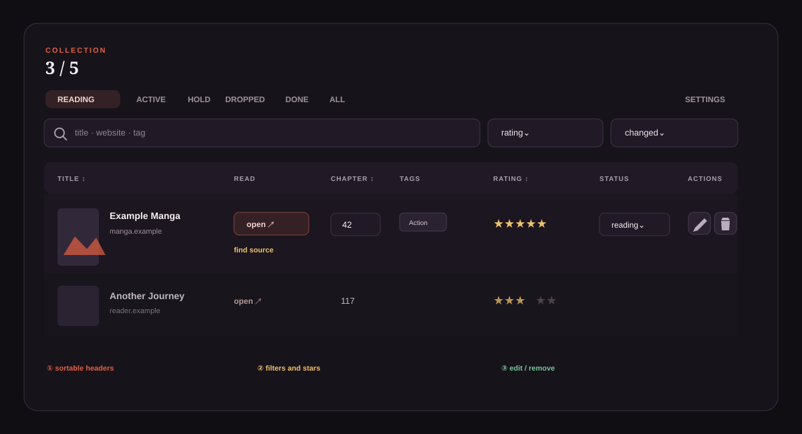

<p align="center"></p>

# Manga Shelf

Save manga and light novel pages in your browser. Track chapters, ratings,
tags and re-reads in a local collection.

**English** · [Deutsch](README.de.md)

[Download Firefox](https://github.com/Raican667/Manga-Shelf/releases/download/v0.20.15/manga-shelf-firefox-0.20.15.zip) ·
[Download Chrome](https://github.com/Raican667/Manga-Shelf/releases/download/v0.20.15/manga-shelf-chrome-0.20.15.zip) ·
[All releases](https://github.com/Raican667/Manga-Shelf/releases) · [Changelog](CHANGELOG.en.md)

**Version 0.20.15** · Firefox 142+ · Chrome 148+ · German / English · GPLv3



## Features

- Six themes shared by the collection, settings, save form and help.

- Capture title, link and available metadata from the current tab.
- Detect chapters from links or maintain them manually; update existing progress.
- Table or card collection views with search, filters and sorting.
- Five- or ten-star ratings, selectable tags and custom categories.
- Separate re-reads linked to primary progress.
- Local covers displayed when visible; custom placeholders assigned by tag.
- Import browser bookmarks by folder, keyword or individual selection; export back.
- JSON backups including covers; optional browser sync for metadata.
- Dark/light mode, German/English and configurable shortcuts.

## Installation

The ZIPs are test packages. **“Code → Download ZIP” and “Source code” are
source archives, not ready-to-use browser packages.**

### Firefox

The current build uses the new Firefox ID `manga-shelf@local.example`. It installs
separately from the previous Manga-Regal ID. Export a JSON backup from the old
extension and import it into Manga Shelf to transfer your collection.

1. Download the Firefox ZIP.
2. Open `about:debugging#/runtime/this-firefox`.
3. Click **Load Temporary Add-on…** and select the ZIP.
4. Pin the icon and open it on a regular website.

Alternatively extract and select `manifest.json`. Temporary installations end
when Firefox closes. Permanent installation requires Mozilla signing.

### Chrome

1. Download and extract the Chrome ZIP.
2. Open `chrome://extensions` and enable **Developer mode**.
3. Choose **Load unpacked** and select the folder containing `manifest.json`.
4. Pin the icon and open it on a regular website.

## Usage

1. Open a manga page and click the extension icon.
2. Review the details, adjust tags and set rating/category.
3. Save or update existing reading progress.
4. Open the collection through the icon or title inside the save form.

[General help](help/index.en.html) · [Settings guide](help/settings.en.html)

## Data and privacy

No separate application account or server. Collection and covers are stored in
the browser profile. Optional sync requires consent and excludes covers, logs
and profile-specific bookmark IDs. Firefox Sync and Chrome Sync are separate;
use JSON backups to transfer between them.

Cover requests may use the existing website session. The extension does not
itself read or store cookies. Bookmark permissions support import/export/updates;
tab and scripting permissions open the form on user action.

Chrome does not require all-sites access on installation. If a cover needs extra permission, **Allow cover domain** requests access only to that image domain. Your manga remains saved if you decline; local image files are still supported.

To avoid individual domain prompts, enable **Settings → Interface → Automatically load covers from all websites** and grant access to all HTTP/HTTPS websites once. This switch is off by default. Switching off revokes broad access without deleting local covers. This browser grant is not synchronized.

[Technical details and permissions](docs/DEVELOPMENT.en.md)

## FAQ

**Why does the icon sometimes open the collection?**

Protected browser pages cannot host the injected form.

**Does it automatically find newly published chapters?**

No. Chapter detection parses the link, not publication status.

**Why is a cover missing?**

Not every page supplies a usable image; access protection may block downloads.
Custom covers and local placeholders are available.

**Will data survive uninstalling?**

Not reliably. Export a JSON backup first.

## Development

Shared codebase for both browsers. Requires PowerShell 7 and Node.js (CI: 24);
no npm installation for packaging.

```powershell
.\build.ps1                   # Tests and both browser packages
.\build.ps1 -Browser firefox
.\build.ps1 -Browser chrome
```

Output in `build/`. The Chrome manifest is derived from the Firefox manifest.

[Contributing and maintenance](CONTRIBUTING.en.md) · [Developer documentation](docs/DEVELOPMENT.en.md)

[Security policy](SECURITY.md)

## Report an issue

[GitHub Issues](https://github.com/Raican667/Manga-Shelf/issues): include browser/version,
extension version and reproduction steps. Never publish cookies, credentials
or private collections.

## License

Copyright © 2026 Raican667.

The current project is licensed under the [GNU General Public License, version 3](LICENSE)
(SPDX: `GPL-3.0-only`). You may redistribute and modify it under that license.
The software is provided without warranty.

GPLv3 permits commercial redistribution; it does not prohibit selling copies.
Previously published MIT versions retain the rights granted under that license.
[License history](docs/LICENSING.md)
